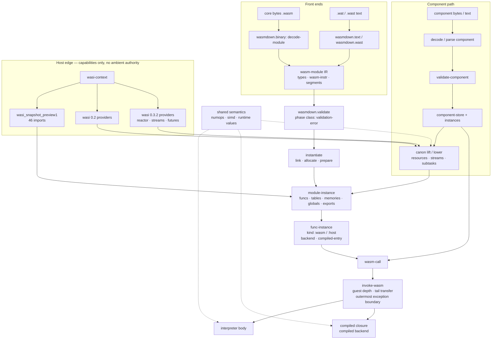

# WASMDOWN

A WebAssembly runtime written in Common Lisp. Binary and text front ends,
validation, a reference interpreter, an SBCL-compiling backend, the
Component Model (canonical ABI, resources, async), and WASI hosts — with
**no third-party Lisp dependencies**.

> **Status: `partial`.** Every subsystem listed below is implemented and
> gated by its own test lane; the engine deliberately omits threads/atomics,
> the FASL cache, and a native optimizer. See [`docs/status.md`](docs/status.md)
> for the per-area matrix and the exact limits.

## At a glance

| Area | State |
| --- | --- |
| Binary decoder / encoder | Full: bounds-checked reader, canonical minimal writer, round-trip tested |
| Text format (`.wat`) and `.wast` scripts | Full: parser, stateful script runner, failure-phase classification |
| Validation | Full for the declared engine scope, including unreachable polymorphism |
| Interpreter (default backend) | Full: exact i32/i64/f32/f64 semantics, v128, GC, EH, tail calls, multi-memory, memory64 |
| Compiled backend | Full for opcode coverage: SBCL `COMPILE` of emitted Lisp, including SIMD, GC, EH and `return_call*`; every pinned core command and component command agrees with the interpreter |
| Component Model | Full lane green: binary + text, validation, instantiation/linking, canonical ABI, resources, async scheduling |
| WASI Preview 1 | Full `wasi_snapshot_preview1` surface (46 imports) |
| WASI 0.3.2 providers | `clocks`, `random`, `cli`, `filesystem`, `sockets` under an explicit capability model |
| WASI 0.2 component facade | 27 of 31 stable interfaces bound at exact release names |
| Threads / atomics, FASL cache, optimized or AOT backend | Not implemented |
| Annotations proposal | Out of scope |

## Execution architecture

Semantic picture of how a guest runs: one IR, one validator, one call
protocol, and two bodies behind it. The module-by-module pipeline (with
every front end and encoder) is in [`docs/architecture.md`](docs/architecture.md).



Two properties hold across the whole graph: the backend is chosen once at
`instantiate` and fills `compiled-entry` on the defined func-instances
(references are never replaced, so imports/exports/tables keep their object),
and every guest call — interpreted, compiled, or across a component boundary —
enters through `invoke-wasm`, which owns depth, tail transfers and the
outermost trap boundary.

## Quick start

Requires **SBCL** (developed against 2.6.4); Python 3 only for the WASI
behaviour lane, Nix only to rebuild the pinned WASI fixtures.

```sh
make test-unit                  # unit + integration suite (672 tests, ~8 s)
sbcl --script tools/wasmdown.lisp help
```

Validate, inspect, and run a core module:

```sh
sbcl --script tools/wasmdown.lisp validate add.wasm
sbcl --script tools/wasmdown.lisp inspect  add.wasm
sbcl --script tools/wasmdown.lisp run      add.wasm --invoke add 42 13
```

Run a WASI guest against the pinned SQLite fixture (built once with
`make wasi-fixtures`, which needs the pinned Nix toolchain):

```sh
printf 'SELECT 6*7;\n' | sbcl --script tools/wasmdown.lisp run \
  tests/fixtures/wasi/sqlite3-p1.wasm --wasi -- -batch :memory:
# 42
```

From Lisp:

```commonlisp
(let* ((module   (wasmdown:read-module #P"add.wasm"))
       (checked  (wasmdown:validate-module module))
       (instance (wasmdown:instantiate checked)))
  (wasmdown:invoke instance "add" 42 13))   ; => (55)
```

## Verification

Every lane is measured, not asserted. Latest numbers (2026-11-01):

| Lane | Kind | Measured | Docs |
| --- | --- | --- | --- |
| `make test-unit` | gate | 672 pass / 0 fail | — |
| `make test-spec-core` | baseline | 21 187 pass / 0 fail / 73 unsupported of 21 260 | [`core.md`](docs/conformance/core.md) |
| `make test-component` | gate | 1 702 pass / 0 fail / 0 unsupported | [`component.md`](docs/conformance/component.md) |
| `make report-component-compiled` | report | 1 702 pass / 0 fail under `:compiled` | `tests/component-compiled/component.md` |
| `make test-backend-parity` | gate | 21 260 / 21 260 core commands agree across both backends | [`backends.md`](docs/conformance/backends.md) |
| `make test-wasi` | gate | 450/450 cases over 30 fresh-process runs | [`wasi.md`](docs/conformance/wasi.md) |
| `make test-wasi-preview3` | gate (explicit) | 7 hand-authored 0.3.2 guests × 3 repeats, both backends | — |
| `make test-property` | gate | 2 000 generated modules, both backends agree | — |
| `make test-upstream` | discovery | aggregated proposal corpus, never a gate | [`upstream.md`](docs/conformance/upstream.md) |
| `make report-backends-bench` | report | per-backend cost medians | [`performance.md`](docs/conformance/performance.md) |

## Documentation

Full index: **[`docs/`](docs/README.md)**.

| I want to… | Read |
| --- | --- |
| Understand the pipeline and module layout | [`docs/architecture.md`](docs/architecture.md) |
| Check what is supported, limited, or planned | [`docs/status.md`](docs/status.md) |
| Use the CLI | [`docs/usage/cli.md`](docs/usage/cli.md) |
| Embed the runtime from Lisp | [`docs/usage/lisp-api.md`](docs/usage/lisp-api.md) |
| Run WASI guests / configure capabilities | [`docs/usage/wasi.md`](docs/usage/wasi.md) |
| Interpret an error or trap | [`docs/usage/errors.md`](docs/usage/errors.md) |
| Reproduce the conformance numbers | [`docs/conformance/`](docs/conformance/README.md) |
| Build, test, and hack on the runtime | [`docs/development.md`](docs/development.md) |
| Read the design contract and milestones | [`docs/design/PLAN.md`](docs/design/PLAN.md) |
| See why a decision was made | [`docs/adr/`](docs/adr/README.md) |
| Read the engineering history | [`docs/history.md`](docs/history.md) |

## License

Not yet chosen — `wasmdown.asd` declares `:licence "TBD"`.
