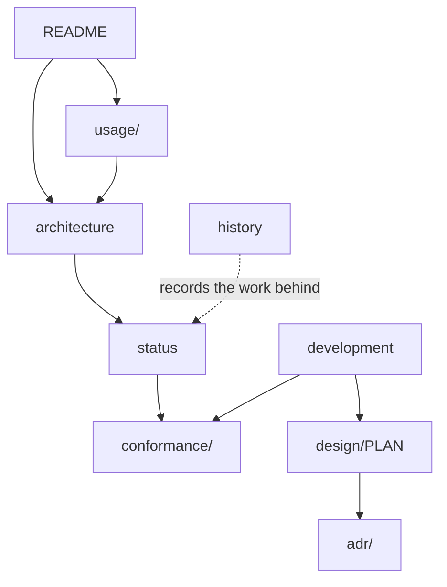

# WASMDOWN documentation

Start with the [project README](../README.md) for the one-page overview.
This directory holds everything that does not belong on the front page.

## Map

| Document | Answers |
| --- | --- |
| [`architecture.md`](architecture.md) | How the pieces fit: front ends, IR, validation, backends, runtime, WASI layering. |
| [`status.md`](status.md) | What is supported, what is partial, what is deliberately out of scope, and what comes next. |
| [`usage/cli.md`](usage/cli.md) | `wasmdown validate` / `inspect` / `compile` / `run`, all options and exit codes. |
| [`usage/lisp-api.md`](usage/lisp-api.md) | Public `wasmdown` API, value domains, backend selection. |
| [`usage/wasi.md`](usage/wasi.md) | Capability model, preopens, WASI Preview 1 and 0.3.2 provider coverage. |
| [`usage/errors.md`](usage/errors.md) | Condition classes, trap kinds, and which phase raises what. |
| [`conformance/`](conformance/README.md) | Lane definitions, pinned suites, and the measured results; [`matrix.md`](conformance/matrix.md) is the backend × ABI view. |
| [`development.md`](development.md) | Build, test targets, repository layout, documentation conventions. |
| [`design/PLAN.md`](design/PLAN.md) | The binding design contract: scope, subsystems, milestones, release gates. |
| [`adr/`](adr/README.md) | Architecture decision records (accepted, one page each). |
| [`history.md`](history.md) | Engineering ledger: per-milestone mechanism notes and measurement history. |
| [`CONTRACTS.md`](CONTRACTS.md) | Cross-slice interfaces that implementation files must not change. |

## Generated vs hand-written

These files under [`conformance/`](conformance/) are **generated by the test
lanes** and must not be edited by hand:

| File | Regenerated by |
| --- | --- |
| `conformance/core.md` | `make test-spec-core` |
| `conformance/component.md` | `make test-component` |
| `conformance/wasi.md` | `python3 tools/run-wasi-suite.py --abi all --commit-summary` |
| `conformance/upstream.md` | `make test-upstream` |
| `conformance/backends.md` | `make report-backend-parity` |
| `conformance/inventory.md` | `make report-backend-inventory` |
| `conformance/performance.md` | `make report-backends-bench` |

`tests/component-compiled/component.md` is the same kind of artifact for the
compiled component run (`make report-component-compiled`); it is not part of
the released gate. Everything else in `docs/` is hand-written.

## Conventions

- One fact, one home: numbers live in `conformance/`, behaviour in `usage/`,
  scope decisions in `status.md` and `design/PLAN.md`. Other pages link
  instead of restating.
- Paths are relative, and links are checked by review rather than tooling.
- `specs/` holds vendored upstream specification text and result pins; it is
  data, not documentation, and is left verbatim.
