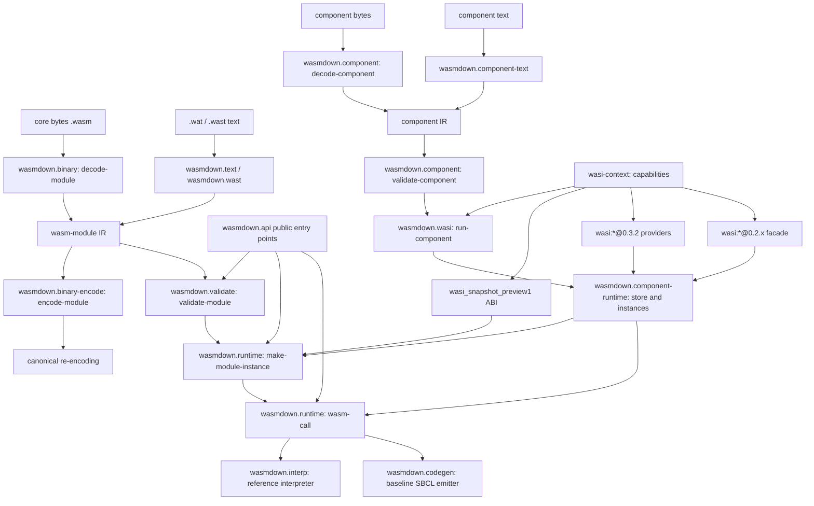

# Architecture

WASMDOWN is a phase pipeline built around one intermediate representation.
Both front ends — core binary and core text — produce the same module IR;
validation consumes that IR; only a validated module can be instantiated and
invoked. The Component Model adds a second pipeline whose instantiation
eventually feeds the same runtime. Every phase owns exactly one failure
class, and those classes are the boundary contract between slices, not an
implementation detail.

## Pipeline

Three properties of that graph are deliberate:

- **Validation sits between every front end and execution.** Text modules are
  parsed straight into the binary decoder's IR, so they pass through the same
  validator as `.wasm` bytes; there is no unvalidated path into the runtime.
- **The text path never re-encodes.** `.wat` and `.wast` scripts produce IR
  objects directly; `encode-module` exists for canonical output and round-trip
  testing, not as a stage of execution.
- **A component runs through the core runtime, not beside it.** A component
  instantiation lowers to core module instances, so `run-component` and a
  plain `instantiate` share memories, tables, the call trampoline, and both
  execution backends.

## Subsystems

One file per subsystem, in `wasmdown.asd` load order; serial loading is what
enforces the dependency direction.

| File | Package | Responsibility |
| --- | --- | --- |
| `src/packages.lisp` | all | Package definitions and the exported symbol set — the visible surface boundary. |
| `src/conditions.lisp` | `wasmdown` | Condition taxonomy: decode, validation, link, instantiation, trap, guest exception, resource exhaustion, host misuse. |
| `src/types.lisp` | `wasmdown.types` | Decoded-module IR: module, function, instruction and segment records shared by every later phase. |
| `src/numops.lisp` | `wasmdown.numops` | Exact scalar primitives: trap conditions, NaN and signed-zero rules, saturating and trapping conversions, little-endian memory helpers. |
| `src/simd.lisp` | `wasmdown.simd` | The v128 representation, the fixed-width SIMD family, and relaxed-SIMD with its documented per-op choices. |
| `src/binary.lisp` | `wasmdown.binary` | Bounds-checked core binary decoder producing the module IR, with `decode-error` carrying byte offsets. |
| `src/component.lisp` | `wasmdown.component` | Layer discrimination, the component binary reader, WIT value types, and the component validator. |
| `src/binary-encode.lisp` | `wasmdown.binary` | Canonical minimal encoder, inverse of the decoder and round-trip tested against it. |
| `src/validate.lisp` | `wasmdown.validate` | Module invariants plus the operand/control-stack algorithm with unreachable polymorphism; never decodes or executes. |
| `src/runtime.lisp` | `wasmdown.runtime` | Instance records, import matching, segment initialization, memory/table/global operations, and the `wasm-call` trampoline. |
| `src/interp.lisp` | `wasmdown.interp` | Reference evaluator over an explicit operand stack, with a guest call-depth limit instead of host stack exhaustion. |
| `src/codegen.lisp` | `wasmdown.codegen` | Baseline backend emitting whitelisted Lisp forms compiled by SBCL `COMPILE`, one host-shaped closure per function. |
| `src/api.lisp` | `wasmdown` | Public entry points over the phases (`read-module` … `invoke`) and backend selection. |
| `src/cli.lisp` | `wasmdown.cli` | `validate` / `inspect` / `compile` / `run` subcommands, stable exit statuses, structured diagnostics. |
| `src/text.lisp` | `wasmdown.text` | `.wat` parser producing exactly the binary decoder's IR, including its immediate plists. |
| `src/wast.lisp` | `wasmdown.wast` | Stateful `.wast` script runner: module registry, assertions, outcome and failure-phase classification, allocation ceilings. |
| `src/component-runtime.lisp` | `wasmdown.component.runtime` | Component instantiation: linking, canon lift/lower, the canonical ABI, resources, and the async scheduler. |
| `src/component-text.lisp` | `wasmdown.component.text` | Component text grammar into the same component IR the binary reader builds. |
| `src/wit.lisp` | `wasmdown.wit` | WIT tokenizer and reader, with WIT-to-component-type conversion. |
| `src/wasi.lisp` | `wasmdown.wasi` | Host-provider framework, the `wasi-context` capability model, the 0.3.2 providers, and the command world driven by `run-component`. |
| `src/wasi-preview1.lisp` | `wasmdown.wasi` | `wasi_snapshot_preview1` linear-memory ABI: fd table, rights, preopen confinement, native services. |
| `src/wasi-preview2.lisp` | `wasmdown.wasi` | WASI 0.2 provider registry, binding each interface at its exact release name. |

The provider framework and both WASI facades share the `wasmdown.wasi`
package: every provider instance and host closure is built in one namespace,
and the facades differ in ABI, not in where they live.

## Data model

The binding definitions live in [`CONTRACTS.md`](CONTRACTS.md); this page only
records why the shape matters.

- **Values** cross every runtime boundary in one canonical domain — unsigned
  Lisp integers for i32/i64, CL floats for f32/f64, one byte vector for v128.
  Signed and bit-exact views are applied per opcode inside `numops`, so no two
  subsystems can disagree about representation. See
  [`adr/ADR-001`](adr/ADR-001-value-representation.md).
- **The module IR** is a graph of `wasm-instr` records carrying `op`, `imms`,
  `body` and an absolute `offset` into the original binary. The offset is the
  source map: every diagnostic can name module, function and byte position.
  See [`adr/ADR-002`](adr/ADR-002-instruction-ir.md).
- **Phase separation** gives each stage its own condition class
  (`decode-error`, `validation-error`, `link-error`, `instantiation-error`,
  `wasm-trap`, `wasm-exception`, plus `resource-exhausted` and `host-error`
  for the embedder boundary). No phase re-signals another's error, so a caller
  can tell a malformed binary from bad typing, an import mismatch, a resource
  limit, and a guest trap without parsing messages.

## Execution backends

`wasmdown.runtime:wasm-call` is the only call trampoline. Host functions are
applied directly; Wasm functions dispatch through the `*invoke-wasm-func*`
hook that the interpreter installs. The baseline backend does not replace that
hook: it compiles each function into a closure with the host-function shape,
so interpreted and compiled functions compose in one call graph and can be
compared on identical instances. See
[`adr/ADR-004`](adr/ADR-004-codegen-bridge.md).

## Host edge

A `wasi-context` is the only source of authority: clocks, entropy, preopened
directories, sockets, stdio, and any embedder transports. WASI Preview 1 is a
core-module facade over those same native services (host functions bound as
imports), while the 0.3.2 and 0.2 providers are component-model providers
materialized as component instances and bound through component `with`-args.
The two ABIs share the native layer and nothing else — which is why they are
separate files rather than modes of one.
