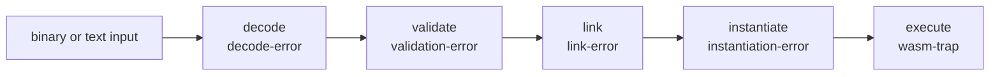

# Errors and traps

Every failure is a condition class exported from `wasmdown`, with a
structured slot for the detail (byte offset, trap kind, exit status).
The classes are never interchangeable: a stage's class says exactly how
far the input got.

## Phase chain

Each stage's class names the failure of that stage; a later class cannot be
raised before the earlier stages have succeeded. Each stage is a precondition
of the next, and `instantiate` re-validates rather than trusting its caller.

## Classes

| Class | Raised by | Means | Message shape |
| --- | --- | --- | --- |
| `decode-error` | `read-module`, `wasmdown.component:decode-component`, the text parser | Malformed binary or text, rejected before validation. Carries `decode-error-offset`, an absolute byte offset. | `wasmdown: decode error at byte N: …` |
| `validation-error` | `validate-module`, and `instantiate` when handed an unvalidated module | Well-formed input that fails static typing or module invariants. Nothing was compiled, allocated, or executed. | `wasmdown: validation error: …` |
| `link-error` | `instantiate` (import resolution), `invoke` (unknown export), `run-preview1` (missing or mistyped `_start`), provider composition | A valid module whose imports or exports could not be matched. | `wasmdown: link error: …` |
| `instantiation-error` | `instantiate` | Valid and linked, but allocation or active-segment initialisation failed (for example segment bounds). | `wasmdown: instantiation error: …` |
| `wasm-trap` | the interpreter, the runtime, and the start function | The guest misbehaved at run time. Carries `wasm-trap-kind`. | `wasmdown: trap (kind): …` |
| `host-error` | the embedding API and the WASI providers | Host-side misuse or a withdrawn capability — not a guest outcome. | `wasmdown: host error: …` |
| `wasi-exit` | `proc_exit` (Preview 1) and `wasi:cli/exit` | A guest-requested exit, not a failure. Carries `wasi-exit-status`. | `WASI exit with status N` |
| `wasm-exception` | a guest `throw` | Internal dispatch only: caught by `try_table`, and converted to a `wasm-trap` of kind `:uncaught-exception` at the outermost guest frame. It never escapes `invoke`. | `wasmdown: wasm exception on tag …` |
| `resource-exhausted` | — | Declared and exported for a documented implementation limit; no current code path signals it. Limits surface as traps or `host-error` instead. | `wasmdown: resource limit: …` |

All of these inherit from `wasmdown-error`, whose message reader is
`wasmdown-error-message`.

## Trap kinds

`wasm-trap-kind` is data on the condition:

| Kind | Cause |
| --- | --- |
| `:unreachable` | The `unreachable` instruction, or an internal invariant the interpreter refuses to continue past. |
| `:out-of-bounds-memory` | A load, store, or memory operation outside the memory's current size, or a memory that cannot be allocated. |
| `:out-of-bounds-table` | Table access outside the table's size, or a `call_indirect` to an unset element. |
| `:integer-divide-by-zero` | Integer division or remainder by zero. |
| `:integer-overflow` | A trapping float→int conversion that is out of range or infinite, or signed division overflow (`INT_MIN / -1`). |
| `:invalid-conversion` | A trapping float→int conversion of a NaN. |
| `:null-reference` | A reference-typed operation on a null reference. |
| `:indirect-call-type-mismatch` | `call_indirect` / `call_ref` whose callee type does not match. |
| `:cast-failure` | A failed `ref.cast`. |
| `:call-stack-exhausted` | Guest call depth exceeded the runtime's limit; reported instead of exhausting the host stack. |
| `:uncaught-exception` | A guest exception no `try_table` caught. |
| `:generic` | A trap raised without a more specific kind, including component-level failures. |

## WASI exits

`wasi-exit` is deliberately a `wasmdown-error` subclass but not a
failure: both runners (`run-preview1`, `run-component`) catch it and
return the status. From Lisp, `run-preview1` returns the raw u32 status
and `run-component` returns the process status; the CLI truncates the
guest status to its low eight bits before exiting.

## How the CLI maps them

| Condition | Exit code |
| --- | --- |
| `decode-error`, `validation-error`, `link-error`, `instantiation-error`, `wasm-trap`, codegen refusal | 1 (any command) |
| A WASI guest's own exit status (truncated to eight bits) | that status |
| Any other `wasmdown-error` under `run`, notably `host-error` | 2 |
| Any other `wasmdown-error` under `validate` / `inspect` / `compile` | 1 |
| CLI usage errors, missing or unreadable file, invalid `WASMDOWN_API_MODE` | 2 |

Diagnostics go to stderr as the condition's own report; results and
summaries go to stdout. See [`cli.md`](cli.md) for the full exit-code
contract.
